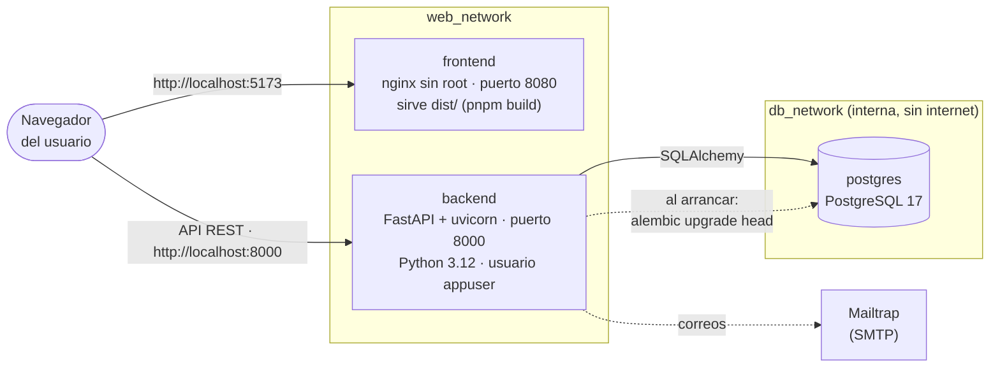
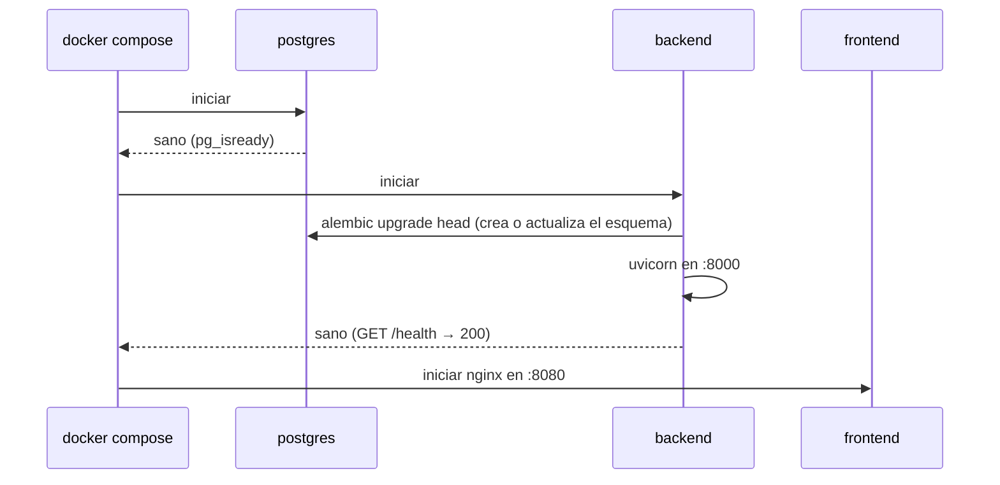
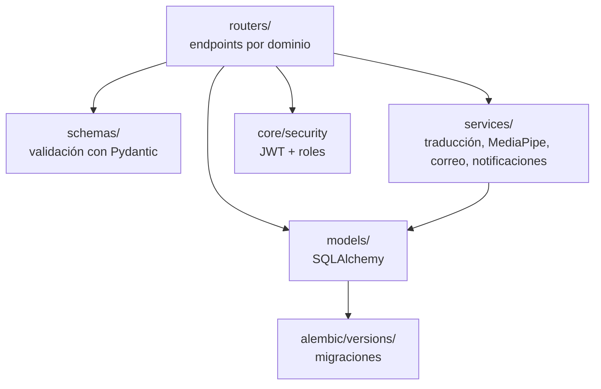
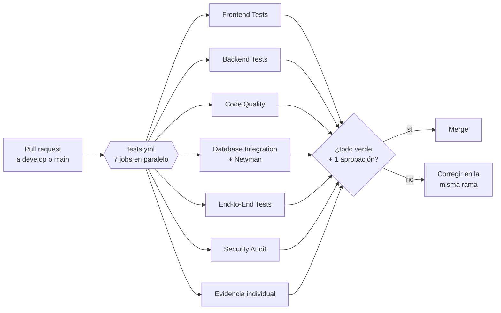

# Arquitectura — SignBridge

Ficha 3228973 B · Cómo se conectan las partes del sistema en la instalación con
Docker Compose y en el CI.

## 1. Contenedores y redes

| Servicio | Imagen | Puerto en el equipo | Espera a |
|---|---|---|---|
| `postgres` | `postgres:17` | 127.0.0.1:5432 | — |
| `backend` | `Backend-SignBridge/Dockerfile` | 8000 | `postgres` sano (`pg_isready`) |
| `frontend` | `Frontend-SignBridge/Dockerfile` | 5173 → 8080 | `backend` sano (`/health`) |
| `postgres-test` | `postgres:17` (perfil `test`) | 127.0.0.1:5433 | — (solo para pruebas de integración) |

La base de datos **no** está en `web_network`: el frontend no puede llegar a
ella, y `db_network` no tiene salida a internet.

## 2. Arranque

## 3. Capas del backend

## 4. Pipeline de CI

